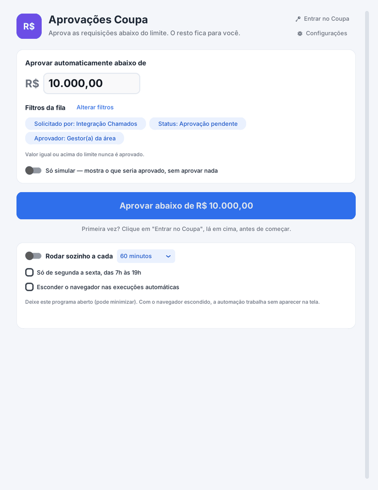
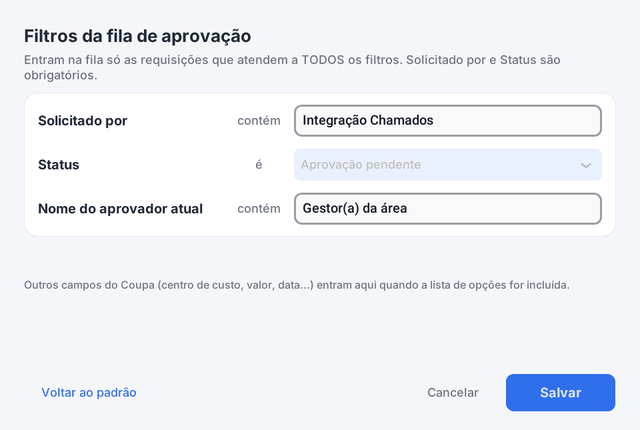
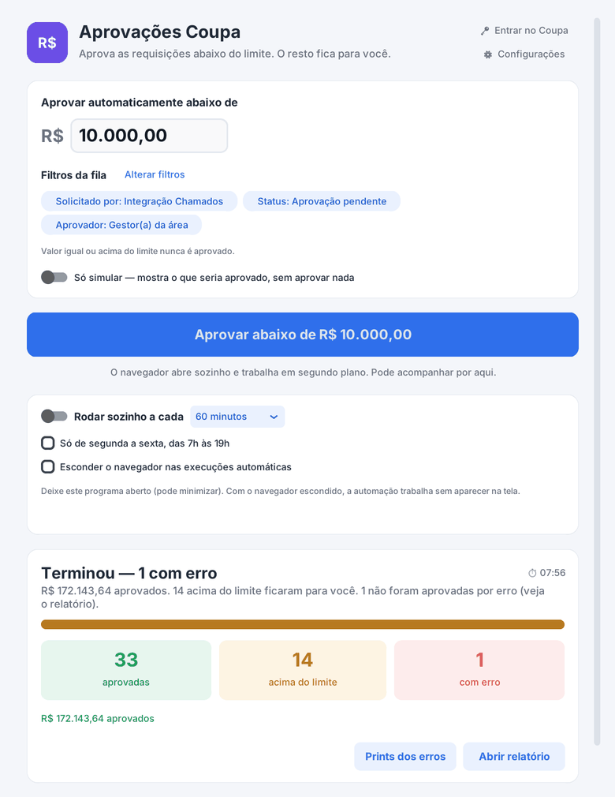

# Aprovações Coupa — Aprovação de Requisições por Limite de Valor

Aplicativo para Windows (Python + Playwright + CustomTkinter) que abre a fila de requisições com aprovação pendente no Coupa, aprova as que estão abaixo de um limite de valor e deixa as demais para análise manual. Pode rodar sozinho em intervalos, durante o horário comercial.

Uso no meu trabalho, no back-office de Manutenção, para as requisições abertas pelo sistema de chamados que ficam aguardando aprovação. Hoje é usado pelos gestores que aprovam essa fila.

<p align="center">
  
  &nbsp;
  
  &nbsp;
  
</p>
<p align="center"><sub>Telas com dados fictícios</sub></p>

---

## Evolução

| Versão | Como era usado |
|---|---|
| 1. Script | `python main.py` no terminal, com resumo só no terminal |
| 2. Aplicativo | Interface gráfica, filtros editáveis, modo simulação, execução automática, relatório em Excel, instalador e atualização automática |

O `main.py` continua funcionando sozinho pela linha de comando; o aplicativo (`app_aprovacoes.py`) usa ele como motor.

---

## Por que existe

Essas requisições chegam em volume e a conferência é sempre a mesma: abrir, ler o valor, aprovar, voltar para a lista. O aplicativo faz essa parte repetitiva, mas **só aprova o que está abaixo do limite**. Todo o resto continua passando por uma pessoa.

---

## Layout

- **Um cartão por decisão**: limite de valor e filtros da fila em cima, botão principal com o valor por extenso ("Aprovar abaixo de R$ 10.000,00"), execução automática embaixo
- **Filtros como etiquetas**: mostram o que a busca vai usar; "Alterar filtros" abre um diálogo, e os filtros obrigatórios não podem ser removidos
- **Resultado em três contadores**: aprovadas, acima do limite e com erro, com o total aprovado em reais e botões para o relatório e os prints dos erros
- **"Só simular"** fica logo acima do botão principal, para conferir o que seria aprovado antes de aprovar de verdade

---

## O que o aplicativo faz

1. Abre o Coupa com a sessão já salva e monta a busca avançada com os filtros combinados:
   - **Solicitado por** contém o texto de `FILTRO_SOLICITANTE` (obrigatório)
   - **Status** = Aprovação pendente (obrigatório)
   - **Nome do aprovador atual** contém o texto de `APROVADOR` (opcional)
   - Antes de mexer em cada filtro, confere se ele já está certo, para não recarregar a lista à toa
2. Para cada requisição da lista:
   - Abre a tela de aprovação; se não houver botão **Aprovar**, pula
   - Lê o valor e converte do formato brasileiro (`1.234,56`)
   - **Abaixo do limite** → aprova (ou só registra, no modo simulação)
   - **Igual ou acima** → não toca, só registra
   - **Qualquer erro** (valor ilegível, tela que não carregou) → não aprova, registra o motivo e salva um print
3. Gera um relatório em Excel com cada requisição, valor e resultado

**Execução automática** (opcional): roda sozinho a cada 30, 60, 90 ou 120 minutos, se quiser só de segunda a sexta das 7h às 19h, e pode esconder o navegador. Basta deixar o programa aberto (pode minimizar).

---

## Distribuição para a equipe

- **Instalador portátil**: um `.zip` com o Python embutido e um `.bat` de instalação. Não precisa instalar Python, pedir acesso de administrador nem ter internet
- **Atualização automática**: ao abrir, o programa olha uma pasta compartilhada (`PASTA_ATUALIZACAO`). Se houver versão nova completa lá, copia os arquivos e reabre sozinho; sem rede, abre a versão instalada (`atualizador.py`)
- **Dados de cada usuário** (login salvo, limite, filtros, relatórios) ficam em `%LOCALAPPDATA%`, fora da pasta do programa

---

## Instalação (para rodar pelo código)

Requisitos: Windows, Python 3.10+ e Microsoft Edge.

```bash
git clone https://github.com/Neres73/Coupa_aprovacoes.git
cd Coupa_aprovacoes

python -m venv .venv
.venv\Scripts\activate

pip install -r requirements.txt
playwright install msedge
```

## Configuração

```bash
copy .env.example .env
```

| Variável | O que é | Padrão |
|---|---|---|
| `COUPA_URL` | Página inicial do seu Coupa | obrigatória |
| `LIMITE_VALOR` | Requisições abaixo deste valor são aprovadas | `10000` |
| `FILTRO_SOLICITANTE` | Texto buscado em "Solicitado por" | obrigatório |
| `APROVADOR` | Texto buscado em "Nome do aprovador atual" | vazio (filtro não é usado) |
| `PASTA_ATUALIZACAO` | Pasta compartilhada das atualizações | — (não atualiza) |

No aplicativo, o endereço do Coupa, o limite e os filtros também podem ser trocados pela tela (⚙ Configurações e "Alterar filtros"). O `.env` e o perfil do navegador estão no `.gitignore` e nunca vão para o repositório.

## Uso

```bash
python app_aprovacoes.py    # aplicativo com interface
```

Pela linha de comando, sem interface:

```bash
python main.py --login        # 1ª vez: abre o Edge para você fazer login; a sessão fica salva
python main.py                # aprova o que estiver abaixo do limite
python main.py --simular      # só mostra o que seria aprovado
python main.py --clear-cache  # limpa o cache do navegador, mantendo o login
```

O aplicativo **não lê, guarda nem digita senha**. Se a sessão expirar, é só entrar de novo pelo botão "Entrar no Coupa".

---

## Limitações

- Os seletores são da interface do Coupa em português no ambiente onde o aplicativo foi feito; outro ambiente pode exigir ajustes
- Um limite único para todas as requisições; não há regra por categoria ou centro de custo
- A execução automática depende de o programa estar aberto e o computador ligado

## Estrutura

```
├── app_aprovacoes.py  # interface (CustomTkinter): limite, filtros, execução automática, resultado
├── main.py            # motor: filtros, leitura do valor, regra de aprovação e relatório
├── atualizador.py     # atualização automática pela pasta compartilhada
├── icone.ico
├── docs/              # prints do README (dados fictícios)
├── requirements.txt
├── .env.example       # modelo de configuração
└── .gitignore
```

---

Desenvolvido por [Gustavo Neres](https://github.com/Neres73), com apoio do Claude (IA) para modelar a lógica, escrever e revisar o código. Projeto compartilhado como portfólio: nenhuma URL, credencial ou dado da empresa está no repositório. Licença MIT.
